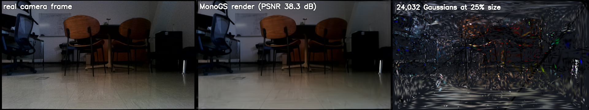
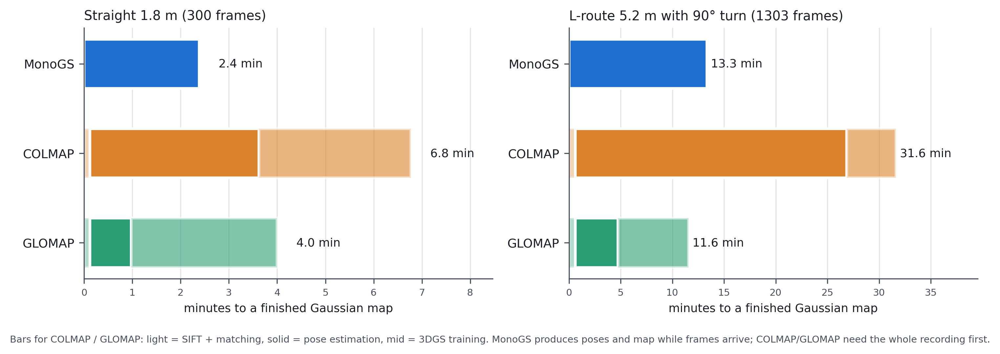
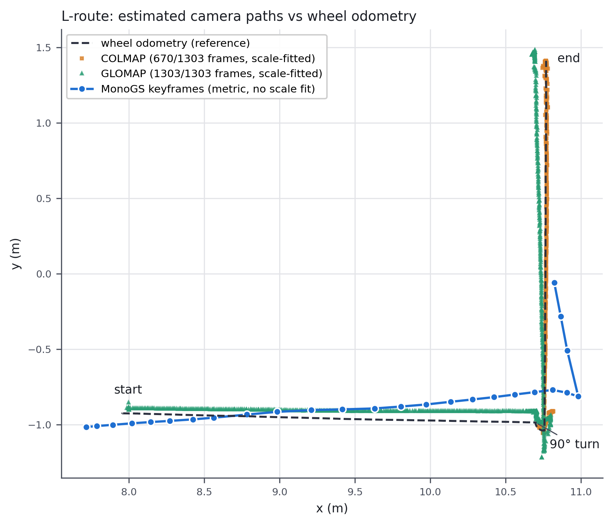
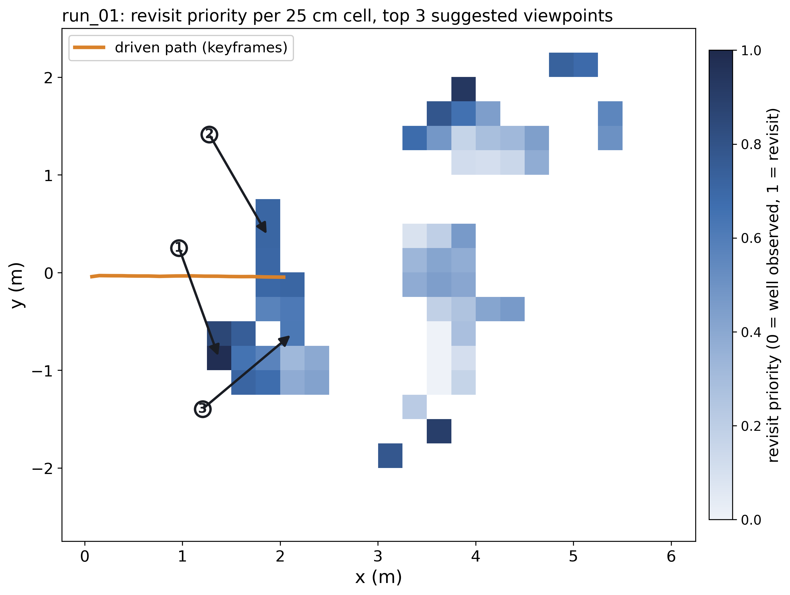

# TurtleBot4 Gaussian Splatting SLAM

Online Gaussian Splatting SLAM ([MonoGS](https://github.com/muskie82/MonoGS)) on real TurtleBot4 RGB-D data, compared against offline structure-from-motion (COLMAP, GLOMAP) + 3D Gaussian Splatting, plus a baseline **revisit planner** that suggests where the robot should look again.

VSI Lab, University of Arizona · Cameron DeBough, Wonhee Koh, Eung-Joo Lee · BARS 2026



## Videos

| | |
|---|---|
| [`media/run_01_flythrough_h264.mp4`](media/run_01_flythrough_h264.mp4) | Fly-through of the MonoGS map, 1.8 m straight drive |
| [`media/run_02_flythrough_h264.mp4`](media/run_02_flythrough_h264.mp4) | Same route, second drive (repeatability) |
| [`media/run_05_L_flythrough_h264.mp4`](media/run_05_L_flythrough_h264.mp4) | 5.2 m L-route with a 90° in-place turn (tracking fails on leg 2, see below) |

## Results (real robot data)

| Route | Method | Online | Time to map | Registered | ATE Sim(3) | ATE SE(3) | PSNR | SSIM | LPIPS |
|---|---|---|---|---|---|---|---|---|---|
| Straight 1.8 m (300 fr) | **MonoGS** | yes | **2.4 min** | 300/300 | 0.9 cm | 7.4 cm | **31.0** | 0.89 | **0.13** |
| | COLMAP + 3DGS | no | 6.8 min | 300/300 | 0.8 cm | n/a | 29.7 | 0.93 | 0.15 |
| | GLOMAP + 3DGS | no | 4.0 min | 300/300 | 0.8 cm | n/a | 29.7 | 0.93 | 0.15 |
| L-route 5.2 m + 90° turn (1303 fr) | MonoGS | yes | 13.3 min | 1303/1303 | 26.2 cm | 28.4 cm | 21.9 | 0.74 | 0.25 |
| | COLMAP + 3DGS | no | 31.6 min | **670/1303** | 2.5 cm* | n/a | 28.1* | 0.93 | 0.13 |
| | **GLOMAP + 3DGS** | no | 11.6 min | 1303/1303 | 8.8 cm | n/a | **28.4** | 0.93 | **0.12** |

Same undistorted frames and fixed PINHOLE intrinsics for every method; COLMAP and GLOMAP share SIFT features and sequential matching. GLOMAP = COLMAP 4.2 `global_mapper`. 3DGS = graphdeco, 30k iterations. ATE is against **wheel odometry, which is not ground truth**; SfM is scale-free, so only Sim(3) ATE applies to it. Image metrics: 3DGS on every 8th registered frame (held out), MonoGS on non-keyframes at its own poses. \*COLMAP L-route values cover only the 670 frames it registered. Sanity check on TUM fr1_desk with the same build: ATE 1.48 cm, PSNR 23.5 dB (paper ≈ 1.5 cm / 23.5 dB).

**Findings.** On smooth motion MonoGS matches SfM path shape (Sim(3) 0.9 vs 0.8 cm) with the best image quality, 2.8× sooner and online; its 7.4 cm metric error is a ~12% scale disagreement with odometry, not drift (which of the two is right is still open). On the L-route each method fails differently at the in-place turn: MonoGS loses leg 2 (low-texture wall over a reflective floor), COLMAP's incremental mapper splits and keeps only leg 2, GLOMAP's global averaging recovers all frames. COLMAP's mapper scales super-linearly (4.3× frames → 7.5× time).




## Revisit planner (baseline)

`analysis/revisit_planner.py` scores 25 cm floor cells of a finished MonoGS map by **view count**, **horizontal viewing-angle spread** (occlusion-tested with rendered depth) and **photometric residual**, then proposes lateral viewpoints (x, y, yaw in the odometry frame, ≤ 1.5 m off the driven path, ≥ 30° new viewing angle) for the top cells. Output: heatmap PNG + JSON goal list (usable with the Create 3 `NavigateToPosition` action). **Not yet validated**: whether the score tracks true reconstruction error needs Isaac Sim ground truth.



## Layout

```
robot/      run ON the TurtleBot4 over ssh (cat script | ssh ubuntu@<robot-ip> bash -s)
  oakd_rgbd.yaml          depthai params: RGB-D 640x360 @ 15 Hz, depth aligned to RGB, IR projector OFF
  oakd_rgbd_start.sh      stop the stock /oakd camera, launch our node /oakd_rgbd (runtime only; reboot restores stock)
  drive_record.sh         record a bag while driving straight (Create 3 DriveDistance)
  drive_route.sh          forward, rotate 90°, forward, with a depth clear-ahead check before each leg
  depth_center.py         clear-ahead / depth-scale check (upper half of the centre patch; ignores floor reflections)
  robot_health.sh, oakd_rgbd_check.sh, snap_near.py, record_test.sh
pipeline/   run on the workstation (WSL2 Ubuntu 24.04)
  install_monogs.sh       MonoGS env for RTX 50-series (sm_120): py3.10, torch 2.7.1+cu128, CUDA 12.8 nvcc, header fixes
  patch_monogs_threads.py MonoGS backend as a thread: WSL2 has no CUDA IPC ("invalid resource handle")
  bag_to_tum.py           ros2 bag(s) -> MonoGS TUM dataset + config (undistort, stamp pairing, mm depth, odom pose.txt)
  inspect_bag.py          sanity checks: rates, RGB/depth pairing, depth validity, TF chain
  sfm_pipeline.sh         COLMAP vs GLOMAP poses + 3DGS training/metrics, every stage timed (resumable)
analysis/   eval_poses.py (ATE, Umeyama Sim3/SE3), compare_figures.py, make_figures.py, splat_viz.py,
            offset_sweep.py, revisit_planner.py, cross_run_eval.py, poster_tables.py
docs/       monogs_input_spec.md (what MonoGS expects), hardware_setup.md
results/    small JSON summaries behind every number above
media/      figures and H.264 fly-through videos
```

## Reproduce (outline)

1. **Robot:** start the RGB-D node (`robot/oakd_rgbd_start.sh`), then record with `robot/drive_record.sh` or `robot/drive_route.sh`. Robot must be on the floor with the path clear; the Create 3 refuses long reverse drives (backup safety limit).
2. **Copy** the bag to the workstation (`scp -r`), convert: `python pipeline/bag_to_tum.py <bag> [<bag> ...] <out_ds> --config <cfg.yaml> [--start S --end S]`.
3. **MonoGS:** `bash pipeline/install_monogs.sh`, `python pipeline/patch_monogs_threads.py ~/MonoGS/slam.py`, then in `~/MonoGS`: `WANDB_MODE=disabled python slam.py --config <cfg.yaml> --eval`.
4. **SfM comparison:** `bash pipeline/sfm_pipeline.sh <dataset_dir> <out_dir> 30000` (conda envs `colmap` = COLMAP 4.2.1 CUDA, `gs3d` = graphdeco 3DGS built for sm_120).
5. **Figures / scores:** `analysis/eval_poses.py`, `analysis/compare_figures.py [--poster]`, `analysis/revisit_planner.py`.

Scripts were written for one workstation and still contain some absolute paths (`~/MonoGS`, `/mnt/c/Users/...`); adjust them for your machine.

## Known limitations

- Trajectory reference is wheel odometry, not ground truth; MonoGS and odometry disagree on scale by ~12%.
- OAK-D Pro IR dot projector disabled: at 800 mA it browned out the robot's internal USB hub (lidar driver hung, Create 3 needed a power cycle). Without it, untextured surfaces give no depth.
- Short routes on one indoor scene; the revisit score is a heuristic baseline.
- Robot bags (~16 MB/s) are not in this repo.
